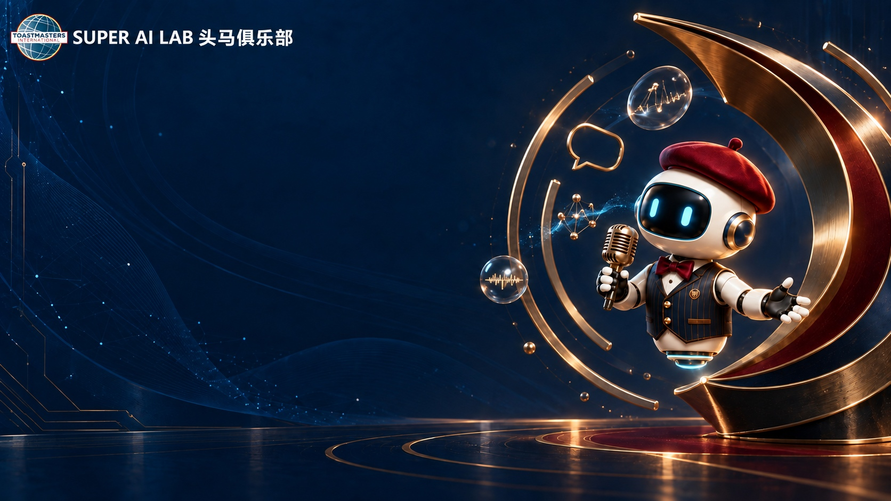

# Super AI Lab Toastmasters Run PPT Skill

一套可独立安装的 Agent Skill：把 Super AI Lab 头马例会的已确认会单、角色接龙或流程表，做成可直接在浏览器投屏的中文 HTML 串场 PPT。

默认采用已认可的**舒文深蓝金色 AI 机器人版**：红色贝雷帽、金色话筒、暖白大字与深蓝舞台。金麦封面、持麦机器人、点评机器人三张背景已随包提供；生成后是一份可离线打开的 HTML，不需要再寻找历史例会文件。此前的蓝红配色保留为 `--style classic`。



俱乐部原名为明源云 AI Lab。新材料使用 Super AI Lab头马俱乐部，历史材料保留当时名称；仓库名与 Skill 标识 `mingyuan-toastmasters-run-ppt` 保持不变，已有安装和调用方式继续可用。

## 能独立完成什么

只安装本仓库后，Codex 或兼容 Agent 即可完成普通例会的最小闭环：

1. 把会单或角色接龙整理成 `meeting.json`；
2. 校验日期、时间轴、角色、演讲与点评对应关系；
3. 从随包舒文机器人模板生成固定 `1920x1080` 的单文件 HTML PPT；
4. 检查 JavaScript、页数、导航、资源路径和未确认占位符；
5. 在浏览器中完成关键页面视觉检查。

不需要本机专用目录、历史例会模板或其他私有 Skill。其他演示、PDF、PPTX 或图像工具只作为可选增强。

## 安装

### Codex

OpenAI 官方文档列出的用户级 Skill 目录是 `$HOME/.agents/skills`：

```bash
git clone https://github.com/FelixMaofei/mingyuan-toastmasters-run-ppt.git \
  ~/.agents/skills/mingyuan-toastmasters-run-ppt
```

也可以只安装到当前项目：

```bash
git clone https://github.com/FelixMaofei/mingyuan-toastmasters-run-ppt.git \
  .agents/skills/mingyuan-toastmasters-run-ppt
```

安装后重新打开相关 Codex 任务。Skill 目录与发现规则见 [OpenAI Codex Skills 文档](https://developers.openai.com/codex/skills/)。

### WorkBuddy

```bash
git clone https://github.com/FelixMaofei/mingyuan-toastmasters-run-ppt.git \
  ~/.workbuddy/skills/mingyuan-toastmasters-run-ppt
```

安装后重启 WorkBuddy。`agents/openai.yaml` 是 Codex 界面元数据，其他 Agent 可忽略。

## 使用

把已确认会单或角色接龙发给 Agent，并说：

```text
用 $mingyuan-toastmasters-run-ppt 根据这份会单制作一份可离线打开的 Super AI Lab 串场 HTML PPT。
使用舒文深蓝金色 AI 机器人版。
缺失信息请一次性列出，不要编造。
```

只想快速跑通匿名示例时：

```bash
python3 scripts/validate_meeting.py examples/meeting.example.json
python3 scripts/build_deck.py examples/meeting.example.json run-ppt/example.html
python3 scripts/check_run_ppt.py run-ppt/example.html
```

打开 `run-ppt/example.html` 即可投屏。支持方向键、空格、Page Up/Down、Home/End、点击、滑动、滚轮和全屏。

机器人版默认隐藏各环节时间范围，封面仍显示会议起止时间；需要显示时，在 `meeting.json` 设置 `"show_schedule": true`。完整时间轴始终保留并校验。旧款式可运行 `python3 scripts/build_deck.py examples/meeting.example.json run-ppt/classic.html --style classic`。

## 输入要求

至少需要：俱乐部名称、期次或会议标签、日期、星期、起止时间、主题、地点、会议经理，以及按顺序排列的环节、负责人和时长。备稿演讲必须提供演讲者、标题及对应点评人。

如果会单缺少会影响事实正确性的内容，Skill 会集中提问；“独立完成”不等于猜测缺失的人名、主题或演讲标题。

本场会单已经确认过的内容直接沿用。用户明确纠正某个姓名、角色或时间后，更新 JSON、重新校验并生成 PPT；只在出现新的冲突或需要额外选择时追问，不重复确认同一事实。修改已有 PPT 时递增 `--version`，并用 `--force` 覆盖指定文件，使浏览器采用新版状态。

## 随包内容

- `assets/shuwen-run-deck-starter.html`：舒文机器人版模板
- `assets/shuwen/`：金麦、持麦机器人、点评机器人三张品牌背景
- `references/shuwen-robot.md`：机器人版布局、复用规则与素材范围
- `assets/run-deck-starter.html`：保留的经典蓝红配色模板
- `examples/meeting.example.json`：完整匿名例会示例
- `references/meeting-input-contract.md`：会议 JSON 输入契约
- `references/deck-standards.md`：Super AI Lab 例会内容与流程标准
- `references/visual-system.md`：固定舞台与视觉规范
- `scripts/validate_meeting.py`：会议事实与时间轴校验
- `scripts/build_deck.py`：从 JSON 生成可用 HTML 初版
- `scripts/check_run_ppt.py`：成品结构、脚本、资源和控制检查

Python 3.10+ 为必需；Node.js 仅用于可选的 JavaScript 语法检查。浏览器视觉检查需要本机可用的浏览器或自动化工具。

## 隐私与商标

仓库不含真实会员名单、联系方式、会议链接、付款或会籍数据、内部会单、历史成品、API 凭据及本机绝对路径。

舒文版三张背景来自已确认的俱乐部串场素材，保留原有 Toastmasters Logo 与 Super AI Lab 字样，用于本俱乐部演示；旧款 `classic` 模板为纯文字身份。背景不含历史期次、人名、会员照片或二维码。详细范围见 [舒文版素材说明](references/shuwen-robot.md)。

上述名称与标识属于各自权利人。本项目是社区制作工具，不代表任何组织的官方背书。MIT License 只覆盖本仓库的原创代码和文档，不覆盖背景中的第三方素材、商标、Logo或字体，不授予相应权利。原成品使用的外部字体未随包分发。

公开分享真实会议文件前，请先移除非必要联系方式、在线会议 ID、付款信息和内部评价。
